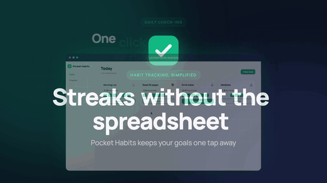
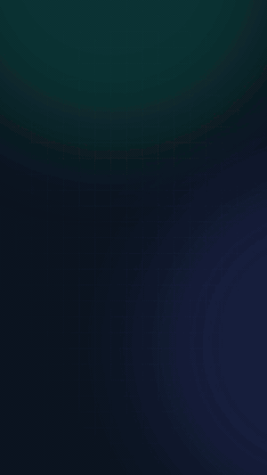
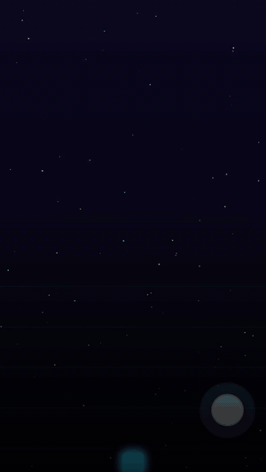

# promo-video-skill

**A Claude Code skill that turns your web app or browser game's codebase into a promo video.**

Point Claude at a project and ask for a video. The skill works out how to run the app, starts
it, drives it like a real user with [Playwright](https://playwright.dev), recording clicks,
typing, taps, swipes and gameplay, and renders a finished MP4 with
[Remotion](https://www.remotion.dev). The footage appears inside browser, phone or tablet
frames, with animated headlines, music and a call to action.

> "Make a 30-second launch video for this app"
> "This is a mobile game on the App Store. Make a vertical trailer with phone frames"

## Examples

These were made by the skill from the two sample projects in [`examples/`](examples). Every
frame of app footage is a real recording of the running app.

<table>
  <tr>
    <td align="center" width="50%">
      <br>
      <b>Web app · 16:9 · browser frame</b><br>
      <a href="docs/media/pocket-habits-desktop-16x9.mp4">▶ Watch full video (23 s)</a>
    </td>
    <td align="center" width="25%">
      <br>
      <b>Mobile app · 9:16 · phone</b><br>
      <a href="docs/media/pocket-habits-phone-9x16.mp4">▶ Full video (19 s)</a>
    </td>
    <td align="center" width="25%">
      <br>
      <b>Mobile game · 9:16</b><br>
      <a href="docs/media/neon-dodge-phone-9x16.mp4">▶ Full video (18 s)</a>
    </td>
  </tr>
</table>

The same storyboard also reflows to other aspect ratios, for example
[Neon Dodge in 16:9](docs/media/neon-dodge-16x9.mp4), where the phone sits beside the
headline App Store style.

- **[`examples/pocket-habits`](examples/pocket-habits)**: a small Vite habit tracker. The desktop
  video uses mouse clicks with a visible cursor. The phone video uses touch taps and swipes on
  an iPhone-sized viewport, a fanned three-phone gallery, an iPad scene, and store badges.
- **[`examples/neon-dodge`](examples/neon-dodge)**: a canvas arcade game, captured fullscreen
  on a phone with seeded touch gameplay.

Their `promo/shots.json` and `promo/storyboard*.json` files are the real inputs behind these
videos. Use them as templates.

## What it does

1. **Detect.** It reads the project and finds the framework (Next, Vite, Nuxt, SvelteKit,
   Astro, Angular, CRA, static HTML, Godot/Unity web exports…), the dev command and port, game
   engine and controls, routes, brand colors, fonts and logo. It also checks whether the
   product targets mobile: Capacitor, Cordova, Ionic, Expo, a PWA manifest, or App Store /
   Google Play links.
2. **Run.** It starts the dev server in the background and waits until the app responds.
3. **Capture.** Playwright records real footage on a desktop, phone or tablet viewport: smooth
   cursor moves and clicks, or touch taps, swipes and long-presses with a fingertip marker,
   plus typing, scrolling and keyboard or touch gameplay. Phones are recorded at full device
   resolution.
4. **Storyboard.** Claude writes the scenes and copy into one JSON file: title, clips,
   screenshots with a slow zoom, feature lists, device galleries and a CTA.
5. **Render.** Remotion renders it inside a browser window, an iOS- or Android-style phone
   (status bar, Dynamic Island or punch-hole camera, home indicator) or a tablet, at 16:9,
   9:16 or 1:1.
6. **Post-process.** ffmpeg handles music, GIFs, compression, trims and raw App Store preview
   cuts.

Everything lands in `<your-project>/promo/`, and every stage can be redone on its own.

## Setup

### 1. Prerequisites

| Tool | Why | macOS | Check |
|---|---|---|---|
| **Node.js 18+** (20/22 LTS recommended) | Runs the scripts, Playwright and Remotion | `brew install node@22` | `node -v` |
| **ffmpeg** | Encodes captures and handles post-production | `brew install ffmpeg` | `ffmpeg -version` |
| **Claude Code** | Runs the skill | [claude.com/claude-code](https://claude.com/claude-code) | `claude --version` |
| **~3 GB free disk** | Chromium (~570 MB), about 550 MB of Remotion per video project, render temp files | – | `df -h ~` |

On Linux: `sudo apt install ffmpeg` and Node from NodeSource or nvm. On Windows, use WSL2.

### 2. Install

```bash
git clone https://github.com/hisyam44/promo-video-skill.git
```

```bash
cd promo-video-skill && ./install.sh
```

`install.sh` installs Playwright and Chromium, symlinks the skill into
`~/.claude/skills/promo-video` (available in every project), and runs a system check. To
install it into a single project instead, use `./install.sh /path/to/project`.

Because it's a symlink, `git pull` updates the skill everywhere. You can re-run the check
any time with `node promo-video/scripts/doctor.mjs`.

### 3. Use it

Start a new Claude Code session in your project, so the skill gets picked up, and ask for a
video:

```bash
cd ~/code/my-app && claude
```

- "Make a 30s launch video for this web app for Product Hunt"
- "It's a PWA we're publishing to the App Store and Google Play. Make a 9:16 promo with phone frames"
- "Make an iPad promo for this app, 16:9"
- "Create a 15-second TikTok ad for my game, fast cuts, gameplay first"
- "Record the onboarding flow and make a feature showcase, use ~/Music/upbeat.mp3 as music"

Claude agrees a short brief with you (length, aspect ratio, device, music, CTA), then runs
the pipeline and reports the output files. Add `promo/` to your project's `.gitignore`.

Optional: install Remotion's official agent skills for deeper Remotion work:
`npx skills add remotion-dev/skills`.

## Desktop and mobile mode

| | Desktop (default) | Mobile (phone / tablet) |
|---|---|---|
| Chosen when | Nothing suggests mobile | You mention mobile, iPhone, Android, iPad or the app stores, or detection finds mobile signals |
| Capture | 1600×900, mouse, arrow cursor | Phone 393×793 @3× or tablet 820×1156 @2×, touch gestures, fingertip marker, mobile user agent |
| Frame | Browser window with URL bar | Phone (iOS or Android style) or tablet, portrait or landscape |
| Extras | – | Device gallery scene, App Store / Google Play badges, raw store-preview cut |

Every project can render all formats from one storyboard: `npm run render` (the storyboard's
size), `render:vertical` (9:16), `render:square` (1:1) and `render:landscape` (16:9).

## Running the pieces by hand

The skill is a set of plain Node scripts (`S` = `promo-video/scripts`), so you can use it
without Claude too:

```bash
node $S/detect_project.mjs . --pretty                # what is this project? mobile?
node $S/run_app.mjs start .                          # start the dev server → prints the URL
node $S/capture.mjs --probe / --device phone         # clickable elements + screenshot
node $S/capture.mjs --plan promo/shots.json          # record clips/stills → promo/captures/
node $S/build_remotion.mjs promo/storyboard.json     # → promo/remotion/ (installs once)
(cd promo/remotion && npm run render)                # → promo/out/promo.mp4
bash $S/ff.sh                                        # list the ffmpeg recipes
node $S/run_app.mjs stop .
```

File formats and guides live in [`promo-video/references/`](promo-video/references):
[shot plan](promo-video/references/shot-plan.md) ·
[storyboard](promo-video/references/storyboard.md) ·
[mobile](promo-video/references/mobile.md) ·
[games](promo-video/references/games.md) ·
[creative direction](promo-video/references/creative.md) ·
[Remotion](promo-video/references/remotion.md)

## Repository layout

```
promo-video/                the skill (what gets installed)
  SKILL.md                  the workflow Claude follows
  scripts/                  detect, run, capture, build, ffmpeg helpers, doctor
  references/               shot plan, storyboard, mobile, games, creative, Remotion
  templates/remotion/       the Remotion project: scenes, device frames, store badges
examples/
  pocket-habits/            Vite web app / PWA (desktop + phone + tablet)
  neon-dodge/               canvas game with keyboard and touch controls
docs/media/                 the example videos and GIFs above
install.sh                  installer
```

## Troubleshooting

| Symptom | Fix |
|---|---|
| `ENOSPC` / "no space left" | Free disk space. `npm cache clean --force` often frees several GB. Delete `promo/remotion/node_modules` in old projects. |
| Doctor says Chromium is missing | `cd promo-video && npx playwright install chromium` |
| Dev server times out | Read `promo/.run/app.log`. Usually it's missing `.env` values, a port already in use, or a database that isn't running. |
| Phone capture looks like the desktop site | The app isn't responsive. `--probe / --device phone` reports `overflowX: true`. |
| Choppy game footage | Desktop: `--headed` or a smaller viewport. Phone: `"deviceScaleFactor": 2`. Don't capture while a render is running. |
| Clip shows a spinner or empty state | Add `waitFor` / `wait` actions, or seed data with `localStorage` / `before` actions |

## Notes

- **Remotion license:** Remotion is free for individuals and companies of up to 3 people.
  Larger companies need a [Remotion company license](https://www.remotion.pro).
- **Store badges:** the badges the skill draws are generic text-only placeholders. For
  official artwork, use Apple's and Google's marketing badge resources.
- **Audio:** browsers can't record app audio through Playwright. Videos use music you
  provide, or a generated placeholder beat.
